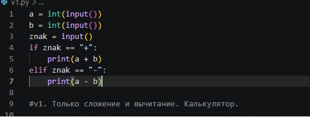
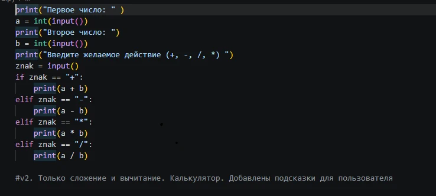
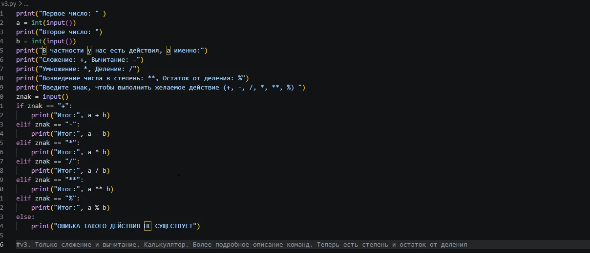

# Название проекта

Калькулятор, что складывает два вводимых числа и выводит ответ

## Запуск
- [Первая версия](v1.py) 
- [Вторая версия](v2.py) 
- [Третья версия](v3.py) 

## Спринт 1. План и первая версия

- **Цель первой версии:** сделать калькулятор

  | Что сделать | Сейчас или позже | Что получилось |
  |---|---|---|
  | Калькулятор | Сейчас | Калькулятор, что может только складывать и вычитать, ввод двух чисел | 

- **Что показали в v1:** Счет вычитания и сложения двух чисел
- **Какое замечание получили:** Слишком маленький код и пока что не оформлен должным образом

## Спринт 2. Доработка после показа

- **Какое замечание взяли из спринта 1:** Доработку версий в будущем
- **Что изменим и как поймём, что готово:** Проверить в терминале

| Что проверили | Что ожидали | Что увидели |
|---|---|---|
| Работу знакой | Полную работу | Не достаточно функций |
| Новая функция | Деление | Умножение |
| Функция из v1 | Сумма | Вычитание |

- **Что вошло в v2:** Новые действия в виде деления и умножения

**Скриншот v2.py.** Замените шаблонную картинку с двумя кубиками своим скриншотом. Покажите, что добавили или исправили после замечания.

## Спринт 3. Запрос на изменение и выпуск

- **Что добавить и зачем:** Более просторное количество математических операций, ошибку при вводе несуществующей операции, объяснение, что делает каждая операция
- **Как понять, что готово:** Проверить каждую комманду и ввести разные числовые значения

| Что проверили | Что ожидали | Что увидели |
|---|---|---|
| Как работают знаки и отсутствие ответа при введения любого другого символа в код | Новые функции | Все работает исправно, но требуются доработки |
| Действие из CR-1 | Умножение, деление, вычитание, сумма| Все работает исправно|
| Старая функция, которую он мог затронуть | Другие математические операции | Вывод на консоль комманд|

- **Что вошло в v3:** Новые действия и так далее

